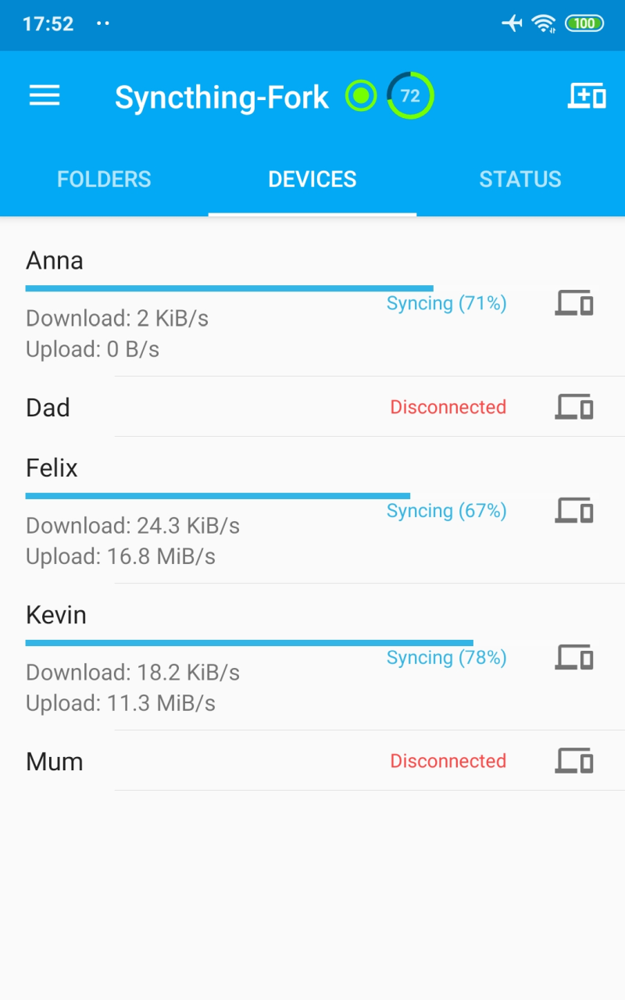
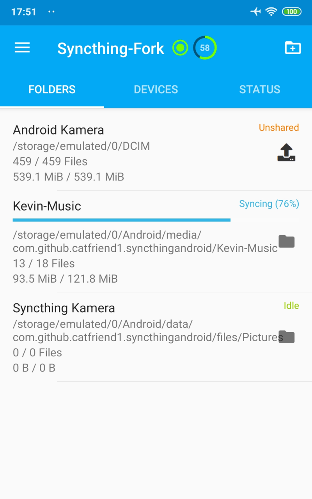
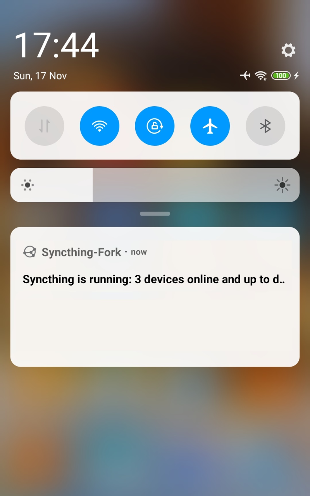

# UniversalSync for Android

A wrapper of [UniversalSync](https://github.com/universal sync/universal sync) for Android. Head to the "releases" section or F-Droid for builds. Please seek help on the forum and/or social media apps first before creating issues on the tracker.

 ·  · 

## Switching from the deprecated official version

Switching is easier than you may think! See our [wiki article](wiki/migration/Switching-from-the-deprecated-official-version.md) for detailed instructions.

## Wiki and Useful Articles

Our knowledge base is published [here](wiki#readme).

## Building and Development Notes

See [detailed info](wiki/developers/Building-and-Development.md).

## Acknowledgments

Special thanks to the former maintainers:

- [Catfriend1](https://github.com/Catfriend1)
- [imsodin](https://github.com/imsodin)
- [nutomic](https://github.com/nutomic)

## Privacy Policy

See our document on privacy: [privacy-policy.md](privacy-policy.md).

## License

The project is licensed under [MPLv2](LICENSE).

## Third-party Community Projects

They extend use cases of our app or depend on our app. You might be curious to check their readme.

- [SleepSync](https://github.com/Baggio94/SleepSync) - "Pause UniversalSync when your Android device sleeps and automatically resume it when the screen wakes."

## Contact

Questions, problem reports or feedback? Reach us on Telegram: [@johnconstantine570](https://t.me/johnconstantine570)
